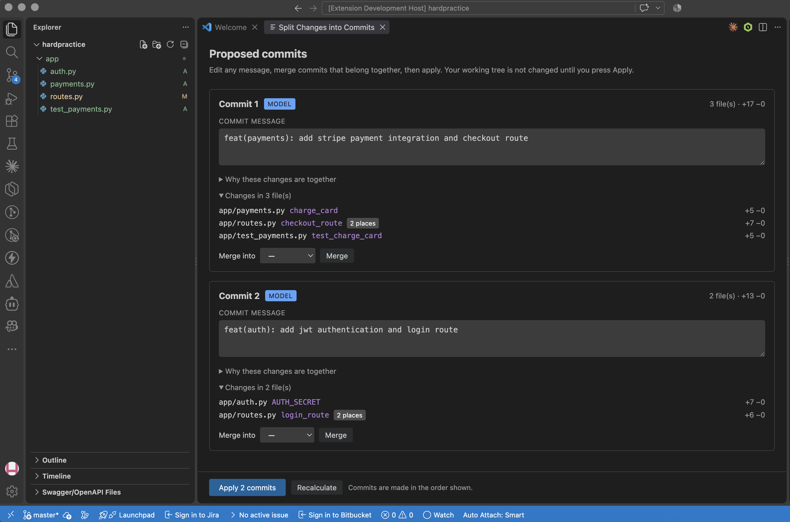
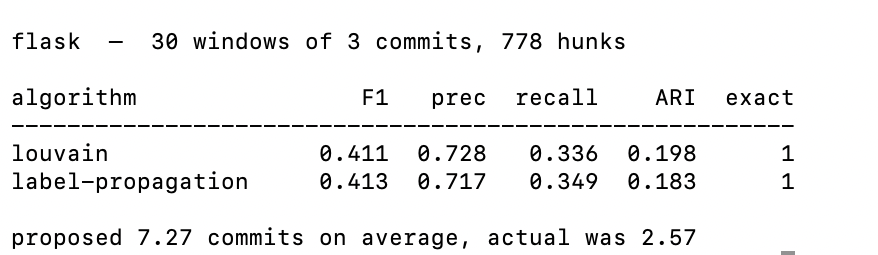

# Atomize Commits

Splits a tangled working tree into separate, well-described commits.

You spent the afternoon on authentication *and* pagination. Now you have
fourteen changed files and one commit message that says "wip". This finds the
seams and proposes one commit per feature, each with a Conventional Commits
message.

**[Install from the VS Code Marketplace →](https://marketplace.visualstudio.com/items?itemName=salonimathure.atomize-commits)**



Two unrelated features edited into the same file, pulled apart automatically.
`login_route` and `checkout_route` sit three lines from each other in
`routes.py`, and they end up in different commits.

---

## The problem

Git decides what belongs together by *proximity*. Two functions written next to
each other land in the same hunk whether or not they have anything to do with
one another, so the smallest thing you can move is already too big. The result
is commits like "wip: auth + pagination + fix" that nobody can revert, bisect,
or review.

## The approach

Model it as community detection.

1. **Cut the diff into hunks**, then cut those further at function and import
   boundaries — otherwise two adjacent features are one inseparable unit.
2. **Score every pair of hunks** on whether they sit in the same function,
   whether one introduces a name the other uses, whether they are an
   implementation and its test, and how much vocabulary they share.
3. **Find the tight clusters** with Louvain modularity optimisation. Each
   cluster becomes a commit.
4. **Order the commits** so nothing is referenced before the commit that
   creates it.
5. **Write the messages** with a language model, or from code structure when no
   model is configured.

The signal that matters most is deliberately *negative*: two hunks in the same
file but different functions score almost nothing. File proximity is exactly
what makes naive tools glue unrelated work together.

## Does it work?

Real repositories are full of ground truth — developers already split their
work into commits. So the benchmark squashes N consecutive commits into one
messy tree and checks whether the tool puts them back.

Comparing two groupings needs care, because labels are arbitrary: our "commit
1" may be their "commit 3". So we score *pairs* — for every pair of hunks, did
the developer group them, and did we?

**Flask, 30 windows of 3 commits, 778 hunks:**

| algorithm | F1 | precision | recall | ARI |
|---|---|---|---|---|
| Louvain | 0.411 | **0.728** | 0.336 | 0.198 |
| label propagation | 0.413 | 0.717 | 0.349 | 0.183 |



**It over-splits** — around 7 proposed commits where the developer made 3.
Precision of 0.73 says the groupings it does make are usually right; the recall
gap is changes a human bundled that share no structural link at all. A feature
and its CHANGELOG entry. A fix and a version bump. Intent is not visible in a
diff, and this approach only sees the diff.

For a tool that *suggests* commits, that is the right way round to be wrong. An
extra commit is a nuisance; a commit bundling unrelated work is the problem the
tool exists to solve.

Louvain and label propagation are within noise of each other here, which is
worth saying plainly. Louvain wins on Adjusted Rand Index and pulls clearly
ahead on graphs with a strong bridge between two dense clusters, so it is the
default — but on real hunk graphs the gap is small.

```bash
python eval/recover.py --repo ~/src/some-project --windows 30 --compare
```

## Running it

**In VS Code** — install from the Marketplace, then run **Split Changes into
Commits**. Requires Python 3.10+; the engine ships inside the extension and
uses only the standard library.

**From the command line:**

```bash
cd engine
python3 -m splitter --repo ~/your-repo group      # see the proposed split
python3 -m splitter --repo ~/your-repo why        # see the raw scores
python3 -m splitter --repo ~/your-repo apply      # do it
```

**As a pull request check** — the GitHub Action builds the container, sends it
the PR's diff, and comments if the PR bundles unrelated changes:

> ### This pull request contains 3 unrelated changes
>
> **1.** `feat(payments): add stripe charging` — 3 files, +17 −0
> **2.** `feat(auth): add JWT verification` — 2 files, +13 −0
> **3.** `fix(api): correct pagination offset` — 1 file, +2 −2

It never fails the build. A tool that blocks merges over style gets switched
off within a week; one that leaves a useful comment gets read.

## Commit messages

Structural heuristics by default — no network calls, nothing leaves your
machine. Configure a model for better ones:

```bash
export SPLITTER_LLM=ollama      # local, free, private
export SPLITTER_LLM=gemini      && export GEMINI_API_KEY=...
export SPLITTER_LLM=anthropic   && export ANTHROPIC_API_KEY=...
export SPLITTER_LLM=openai      && export OPENAI_API_KEY=...

python3 -m splitter --repo . doctor
```

The model never sees the full diff — only a compact summary of each proposed
commit. Every reply is validated against Conventional Commits before use;
unknown types, empty subjects and over-long headers are repaired or rejected,
and anything unusable falls back to the heuristic message.

| | Message |
|---|---|
| heuristic | `feat: add charge_card, checkout_route, test_charge_card` |
| model | `feat(payments): add stripe payment integration and checkout route` |

## Layout

```
engine/      the analysis. Pure standard library, so it can be bundled.
service/     FastAPI wrapper. Stateless; never commits anything.
extension/   the VS Code extension. A thin client over the engine.
ci/          the pull request check.
eval/        the benchmark harness.
```

`engine/splitter/core.py` is the seam: it takes a diff and a file-content
lookup and returns proposed commits. Nothing in it knows about git, HTTP or
editors. That is why the CLI, the extension and the API share one
implementation, and why swapping Flask for FastAPI touched a single directory.

| | Tests | Covers |
|---|---|---|
| `engine/tests` | 50 | parsing, splitting, grouping, ordering, messages |
| `extension/test` | 44 | argument building, merging, HTML escaping |
| `ci/tests` | 25 | the PR check, against a stub HTTP server |
| `service/tests` | 22 | the analysis core and the HTTP API |
| `eval/tests` | 10 | the scoring metrics |

```bash
make test
```

## Notes on the implementation

**No dependencies in the engine.** Louvain and the topological sort are written
out in `graphs.py`. An extension that says "first install Python, then pip
install networkx" is one nobody keeps.

**Applying a partial patch is the load-bearing trick.** Patches go to the git
*index*, which equals HEAD at that moment, so every hunk's `-` side line numbers
are correct no matter which hunks we skip. Only the `+` side needs recomputing:

```python
new_start = old_start + offset
offset   += (new_count - old_count)   # advances only for included hunks
```

Get it wrong and git applies the change in the wrong place.
`test_skipping_middle_hunk_lands_correctly` is the guard.

**Everything degrades.** No model configured, model unreachable, model returns
a made-up commit type, model wraps its JSON in prose — each falls back to a
valid heuristic message. A tool that rewrites git history must never break
because an API call timed out.

## Known limits

- Mixed add/remove hunks are never split; only runs of pure additions are cut.
- Symbol detection is regex-based, not a real parse. Good on ordinary Python,
  JS/TS, Go and Java. `symbols.py` is the only file tree-sitter would replace.
- Binary files and renames travel whole.
- Nothing verifies that each commit actually builds. The ordering pass catches
  name-level dependencies, which is a proxy rather than a proof.

## Licence

MIT.
